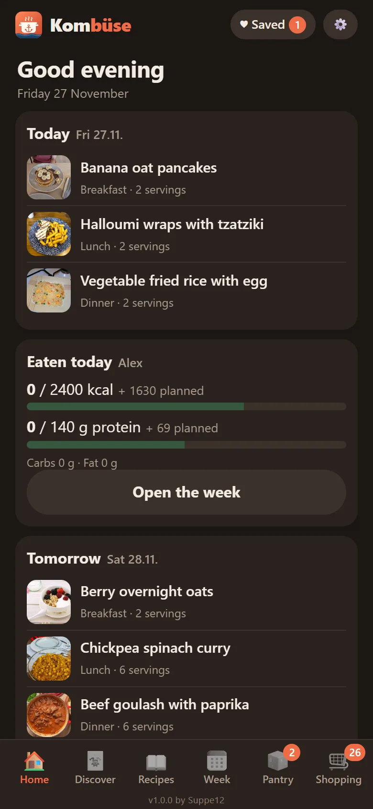
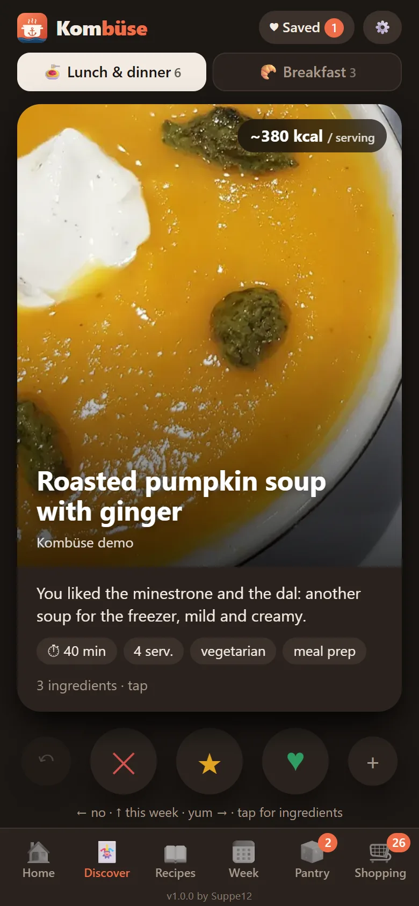
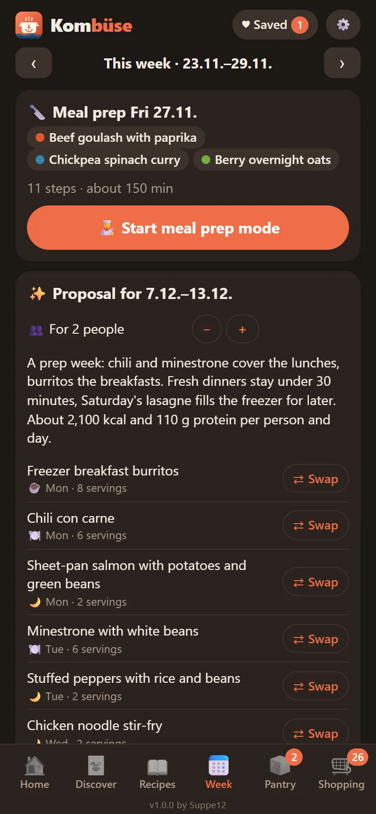
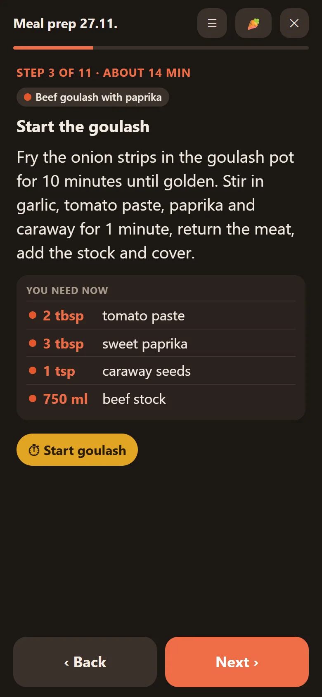
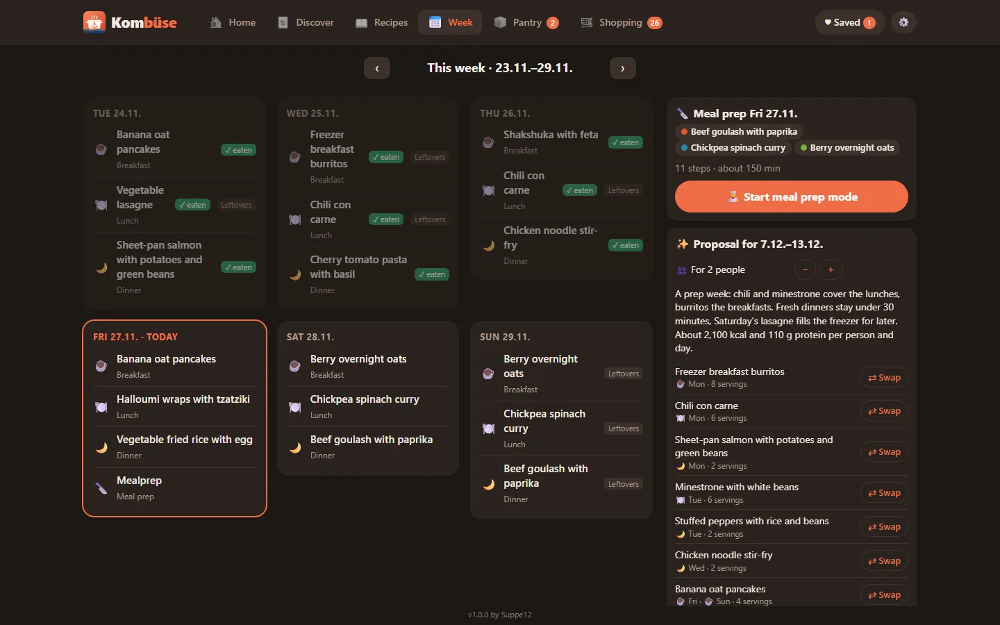

# Kombüse

A self-hosted kitchen app for one household: discover dishes by swiping, keep your recipes, plan the week,
cook step by step, track your freezer and cupboard, and turn it all into a shopping list – with an AI that learns
what you like, using Claude, a local model or your own agent.

> **Status:** young. Kombüse runs daily in one home. It has sign-in, CSRF and SSRF protection and encrypted
> credentials, but has not had an external review yet: prefer a trusted network or VPN over exposing it directly to
> the internet.

<p>
  
  
  
  
</p>


More: [recipes](docs/screenshots/desktop-recipes.webp), [a recipe](docs/screenshots/phone-recipe.webp),
[shopping list](docs/screenshots/phone-shopping.webp), [pantry](docs/screenshots/phone-pantry.webp),
[settings](docs/screenshots/desktop-settings.webp) – all with the demo data below.

## Try it

Start an empty installation with a demo household – 22 recipes, swipe cards, a week plan with a meal prep day,
shopping list, pantry and two members:

```sh
cp docker-compose.example.yml docker-compose.yml
KOMBUESE_DEMO=true docker compose up -d --build      # or: environment KOMBUESE_DEMO=de for German
docker compose logs kombuese | grep Demo             # the password of the account "demo", shown once
```

Or into an existing empty installation: `docker exec kombuese python /app/tools/admin.py demo [--lang de]`.
The demo only fills an installation without accounts; to start over, stop the container and empty the data directory.

## Features

- **Discover:** a stack of dishes to swipe (no / like / cook this week), filled by an AI run that searches recipe sites
  and learns from your choices and your reasons for “no”
- **Recipes:** your own collection with photos, scaled ingredients, nutrition per serving, star ratings, editing,
  import from a link, **recipes from cooking videos** (TikTok, Instagram, YouTube, with Whisper), **PDF export**
- **Week:** meal plan with leftovers and frozen portions (with microwave reheating times for your microwave's watt), AI week plan proposals, a **meal prep mode** that interleaves
  several recipes step by step, a **cooking mode** with timers and screen wake lock
- **Pantry:** freezer with expiry dates, **cupboard** with shelf-stable stock, a **barcode scanner** (Open Food Facts)
- **Shopping:** one list from all planned recipes, merged and rounded to packs, minus what is in the cupboard;
  optionally sent to Bring!, where ticked-off items move into the cupboard
- **AI your way:** Claude via the Anthropic API, any OpenAI-compatible model (OpenAI, Ollama, LM Studio …), or your
  own agent through the built-in **MCP server**; cost limits and a log of every run
- **Household:** several accounts, sign-in with your own identity provider (OIDC), German and English, backup and
  moving to a new server in one file
- **Nutrition and sharing:** what everybody ate, per person with daily goals and what the plan still holds;
  share a recipe with a public read-only link (revocable)
- Optional: log meals to Yazio too, week plan as an iCal feed (e.g. for Home Assistant), notifications via Telegram or ntfy

## Quick start

```sh
cp docker-compose.example.yml docker-compose.yml   # adjust KOMBUESE_URLS
docker compose up -d --build
```

Open http://localhost:9926 and create the first account (it becomes the admin), or restore a backup of another
installation. Then set the household language under ⚙️ Settings → Household.

## Documentation

- [Installation](docs/installation.md) – Docker, HTTPS, updating, command line, troubleshooting
- [Configuration](docs/configuration.md) – environment variables, accounts and OIDC, household, connections, calendar
- [AI](docs/ai.md) – jobs, providers, costs, local models, MCP server, example worker
- [Recipes from videos](docs/video.md) – TikTok, Instagram, YouTube; Whisper, yt-dlp, privacy
- [Backup and moving](docs/backup.md)
- [HTTP API](docs/api.md) – and in every installation the interactive API docs (Swagger UI) at `/api/docs`, the
  OpenAPI 3.1 description at `/api/openapi.json`

## Credits

- Barcode scanning: [ZXing](https://github.com/zxing-js/library) (Apache-2.0, see `app/static/zxing-LIZENZ.txt`)
- API docs: [Swagger UI](https://github.com/swagger-api/swagger-ui) by SmartBear Software (Apache-2.0, see
  `app/static/apidocs/LICENSE` and `NOTICE`)
- Product data: [Open Food Facts](https://world.openfoodfacts.org) (ODbL)
- PDF rendering: [Gotenberg](https://gotenberg.dev)
- Demo photos: Wikimedia Commons authors under CC0, CC BY and CC BY-SA, see [tools/demo/images/CREDITS.md](tools/demo/images/CREDITS.md)

## License

Kombüse is free software under the [GNU Affero General Public License v3.0 or later](LICENSE) (AGPL-3.0-or-later).
You may use, change and share it; if you run a changed version as a service for others, you have to offer them its
source code. Bundled third-party parts keep their own licenses (see Credits).
